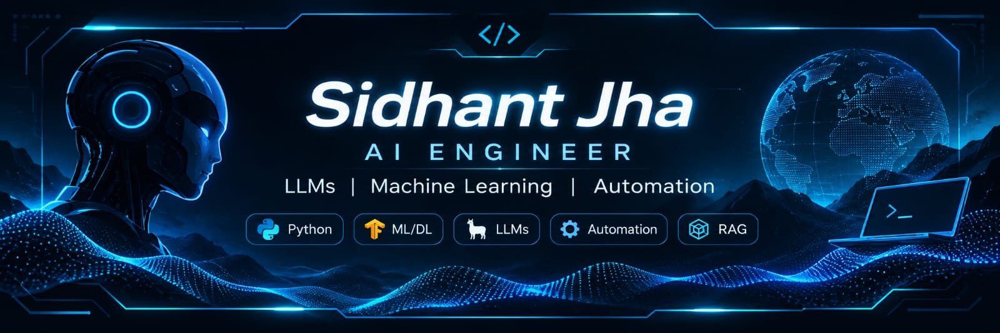

# Hi there, I'm Sidhant Jha 👋

  

# 💫 About Me

I'm **Sidhant Jha**, a B.Tech graduate in Artificial Intelligence and Machine Learning, passionate about building intelligent applications and solving real-world problems through technology.

I enjoy working with Machine Learning, Deep Learning, Generative AI and AI-powered automation. My focus is on developing practical applications, experimenting with AI models and exploring intelligent agent architectures.

### 🎓 Education

**B.Tech in Artificial Intelligence and Machine Learning**

Dr. A.P.J. Abdul Kalam Institute of Technology, Tanakpur.

### 🛠️ Skills

**Programming:** Python, SQL

**Libraries & Frameworks:** NumPy, Pandas, Matplotlib, Scikit-learn, PyTorch, TensorFlow, OpenCV

**AI & Generative AI:** LLMs, LangChain, Hugging Face, Ollama, RAG, Multi-Agent Systems

**Backend & Development:** FastAPI, REST APIs, SQLite, Git, GitHub

### 🚀 Currently Working On

- Exploring LLM application development and Retrieval-Augmented Generation (RAG).
- Building and experimenting with Multi-Agent AI systems.
- Improving my knowledge of Deep Learning and attention-based architectures.
- Developing AI-powered automation applications.

---

## 🌐 Socials

  <a href="https://github.com/jhasidhant234-stack">
    GitHub
  </a>
  &nbsp; | &nbsp;
  <a href="https://www.linkedin.com/in/sidhant-jha/">
    LinkedIn
  </a>

---

## 💻 Tech Stack

### 👨‍💻 Programming Languages

### 🤖 Machine Learning & Deep Learning

### 📊 Data Analysis & Visualization

### 🧠 Generative AI & LLM Engineering

### 👁️ Computer Vision

### ⚙️ Backend & Development Tools

---

## 🚀 Featured Projects

| Project | Description |
|---|---|
| [Traffic Flow Prediction](https://github.com/jhasidhant234-stack/Traffic-Flow-prediction) | Traffic forecasting using LSTM and time-series analysis |
| [Multi-Agent AI](https://github.com/jhasidhant234-stack/Multi_Agent_Ai) | Modular AI assistant and agent-based architecture |
| [Customer Churn Prediction](https://github.com/jhasidhant234-stack/Customer_churn_prediction) | Machine Learning-based customer churn prediction |
| [Job Searcher](https://github.com/jhasidhant234-stack/job-searcher) | Job search and application workflow automation |
| [IMDb Content Performance Dashboard](https://github.com/jhasidhant234-stack/imdb-content-performance-dashboard) | Data analysis and content performance visualization |
| [Face Attendance System](https://github.com/jhasidhant234-stack/Face_Attendance_system) | Automated face recognition-based attendance tracking using Python, OpenCV, and SQLite with real-time detection and user management |
| [Internship Recommendation Engine](https://github.com/jhasidhant234-stack/Internship_Recommendation_Engine) | NLP-based internship recommendations using TF-IDF vectorization and cosine similarity |

---

## 📊 GitHub Statistics

---

## 🐍 Contribution Activity

---

### 💡 BUILD • EXPERIMENT • LEARN • REPEAT

*Always curious. Always building. Always improving.*

